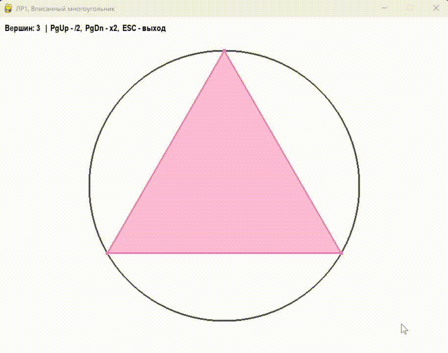

# Лабораторная работа по дисциплине "Компьютерная графика" №2: Построение геометрических изображений 

## 📝 Описание задачи
Программа реализует отображение окружности заданного радиуса и вписанный в неё правильный многоугольник. 

## 🎬 Демонстрация работы


## Программа реализована на языке:

| Язык | Интерпретатор/Версия | Среда разработки |
| :--- |:---------------------|:-----------------|
| Python | Python / 3.15        | PyCharm 2024.2.4 |

## 🎮 Управление
*   **PgDn** (или `Fn` + `Стрелка вниз`) — удвоить количество вершин многоугольника.
*   **PgUp** (или `Fn` + `Стрелка вверх`) — уменьшить количество вершин в два раза.
*   **ESC** — выход из программы.

## 🛠 Технические особенности реализации
*   **Графика:** 2D-ортогональная проекция реализована средствами OpenGL.
*   **Логика:** Координаты вершин многоугольника вычисляются динамически с помощью тригонометрии (`sin`, `cos`) в функции `get_polygon_vertices`.

## 🚀 Установка и запуск
Для запуска вам понадобится Python 3.8+ и установленные библиотеки.

**Шаг 1. Склонируйте репозиторий (или скачайте папку с проектом):**
```bash
git clone https://github.com/YuliaLesnykh/LR2_Geometric_Images.git
cd LR2_Geometric_Images
```
**Шаг 2. Рекомендуется создать виртуальное окружение:**
```bash
python -m venv venv
.\venv\Scripts\activate
```
**Шаг 3. Установите необходимые библиотеки:**
```bash
pip install -r requirements.txt
```
**Шаг 4. Запустите программу:**
```bash
python main.py
```
